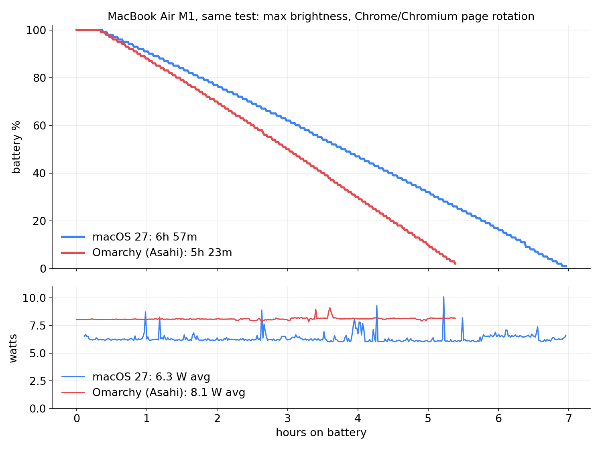

# battery-test

Same battery run on macOS and on Omarchy (Asahi Linux) on one MacBook Air M1.

## Result (2026-10-23)

| | macOS 27.0.1 | Omarchy 4.5 (Asahi) |
|---|---|---|
| 100% to shutdown | **6 h 57 m** | **5 h 23 m** (-23%) |
| average draw | **6.34 W** | **8.10 W** (+28%) |
| energy drawn | 43.4 Wh | 43.6 Wh |

Details, versions and per-hour numbers: [results/README.md](results/README.md). Raw logs: `results/*.csv`.

## How to run it

1. Charge to 100%, unplug. Brightness at maximum (the only level that matches on both OSes; auto-brightness and True Tone off), Wi-Fi on, Bluetooth off, nothing else open.
2. Open `workload.html` full screen in Chrome (Chromium on Omarchy, its default, so both runs use the same engine): a different public page every 60 s.
3. In a terminal, with the screen kept awake (otherwise the display sleeps and the run measures nothing):
   - macOS: `caffeinate -di ./battlog.sh macos-run1.csv`
   - Omarchy: run `omarchy-toggle-idle` first (Omarchy 4 has no hypridle, the shell blanks the screen), then `systemd-inhibit --what=idle:sleep ./battlog.sh omarchy-run1.csv`
4. Leave it until the laptop shuts down. The CSV keeps the last line it wrote.

Compare: hours from 100% to the end, and the average watts while discharging.

Chart: `python3 chart.py results/battery.png` from `results/` (needs matplotlib).

Note: news.ycombinator.com refuses to load in an iframe, so that slot shows a blank page; it does so on both systems.
